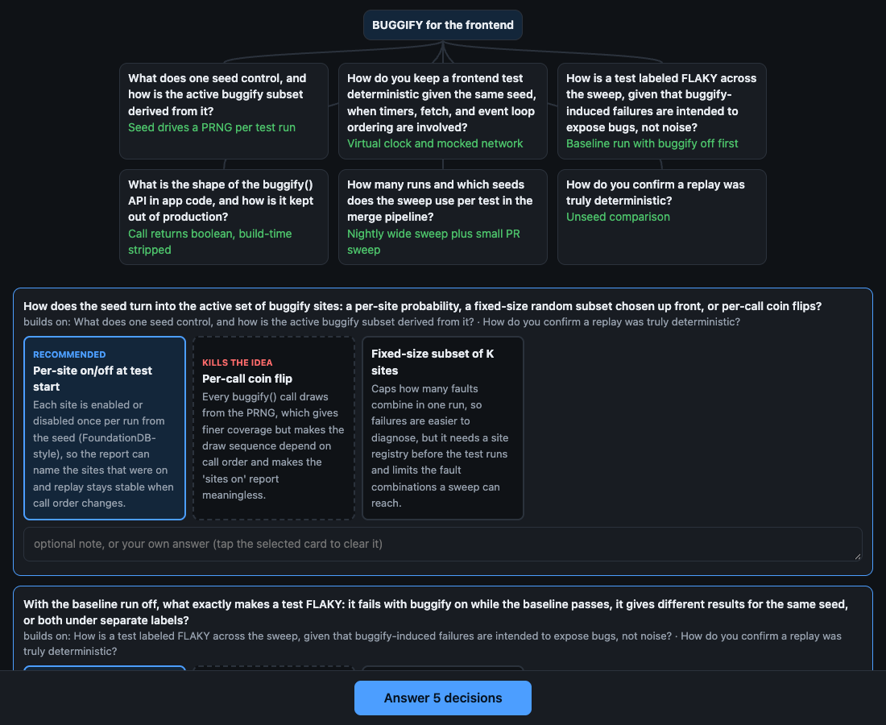
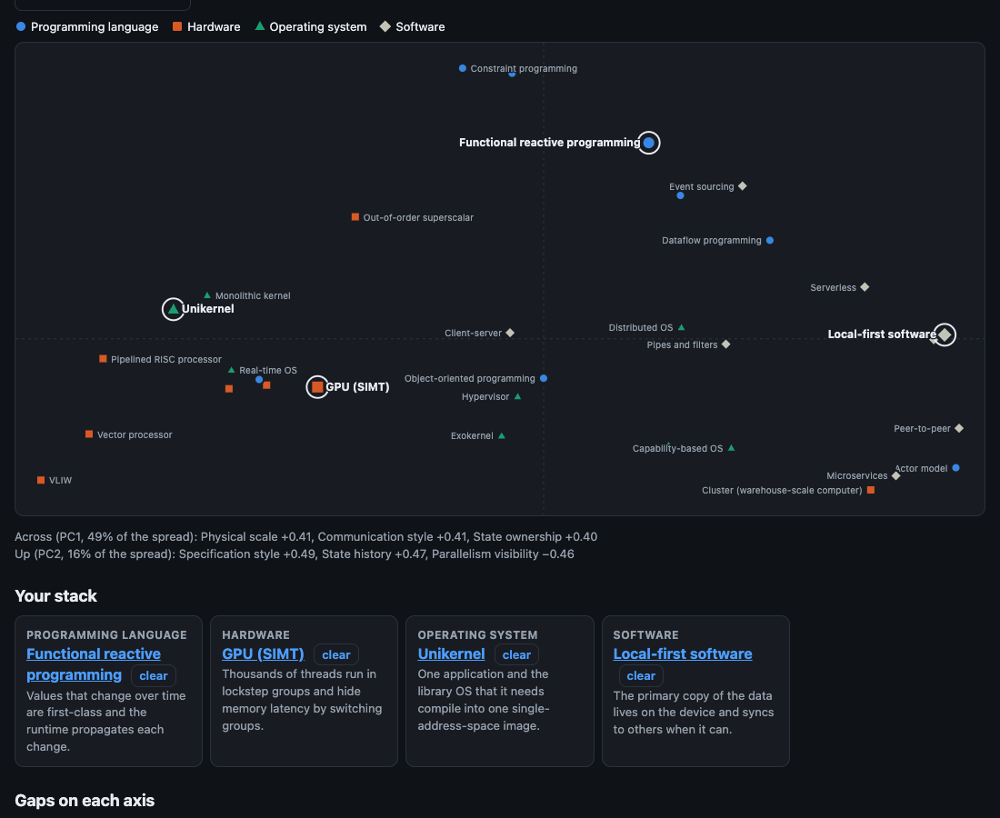

# snowmobile

Snowmobile hunts real software tools and programming paradigms for their parts, and recombines distant parts into new developer tools, or into consumer apps in Stack mode. It kills each idea that already exists, then grills you on a survivor as a visual design tree: one tap per decision, until you have a build brief.



```
seed ──► hunt parts ──► recombine ──► prior-art check ──► grill tree ──► build brief
         (web search)                  (dead ones go to                (a decision that kills the
                                        the graveyard)                  idea marks the bad part)
```

## Start

You need Node.js 22.13 or later and [Claude Code](https://claude.com/claude-code), signed in. Snowmobile runs your local `claude` CLI, so it uses your own login and needs no API key.

```sh
npx github:yujieteo/snowmobile
```

Open the URL that it prints. The URL holds a token. Without the token, the server refuses each request.

Snowmobile is a server because a browser cannot run Claude Code, and because you can then use it from your phone.

## Use it from your phone

The server listens only on `127.0.0.1:4747`. From a device with SSH access to the machine that runs snowmobile, forward the port:

```sh
ssh -L 4747:127.0.0.1:4747 your-machine
```

Then open the printed URL, with its token, in the browser on that device.

## Your data

Everything stays in one SQLite file on your machine: `~/.snowmobile/snowmobile.db`. It holds the parts and their source links, the paradigms, axes and scores of the stack map, the ideas, the graveyard and each grill tree. The library page searches the hunts, the parts and the ideas. Set `SNOWMOBILE_HOME` to keep the file somewhere else, and `PORT` to change the port.

## How it works

- **Hunt.** From your seed (a pain, a domain, a tool or a paradigm), Claude searches the web for 6 real tools and paradigms. It breaks each one into its principal components: the mechanisms that make it work, each with a link to its source. "Hunt more parts" adds more.
- **Create.** Claude combines parts from distant sources into candidates. Each candidate must name the problem and who has it, a link that shows the problem is real, the solution that people use today, and the gain over it on one axis, with a claim that a test can prove false. Claude then searches for prior art. A candidate that exists, that has no real source for its problem, or that has no clear gain goes to the graveyard with the reason. The idea card shows these 4 lines first.
- **Grill.** Each round shows every open decision whose prerequisites are settled, with the recommended card already selected. One tap answers the round. Tap another card or type a note to override. While you read a round, snowmobile already computes the next round for the recommended answers, so the next round usually appears at once. The first round always tests why the idea is better than the solution that people use today. A decision that kills the idea sends you back to the hunt with the bad part marked, and the next creation leaves that part out. The build brief starts with the problem, the evidence, today's solution and the gain.

## Stack mode

Stack mode makes consumer apps from a stack of 4 paradigms: one programming language paradigm, one hardware paradigm, one operating system paradigm and one software paradigm. Open **stack** in the menu.



- **Paradigms.** The map starts with 32 paradigms from books: Van Roy's taxonomy for languages, Patterson and Hennessy for hardware, the kernel designs of an operating systems book, and the main software architecture styles. "Hunt more paradigms" finds more on the web, each with a source link.
- **Axes.** Claude proposes 8 to 12 design axes once, for example where state lives or when binding happens. Each axis runs through all 4 layers. Then Claude scores each paradigm on each axis from 0 to 10, with a one-line reason. You can edit each axis and each score. A new score never replaces your edit.
- **Map.** Principal component analysis puts all paradigms on a 2D map, with a colour and a shape for each layer. Tap a mark to pick it for its layer. Tap an empty area, and Claude tells you which paradigm would live at that point.
- **Gaps.** With 2 or more picked paradigms, the page shows the gap between them on each axis. A gap of 5 or more is a mismatch: a chance for a new idea.
- **Create.** Write a consumer pain, pick a stack, or do both. If you do not pick a paradigm for a layer, Claude chooses one. Claude then proposes consumer apps that the stack makes possible, cheap or fast. The same checks as above send weak apps to the graveyard. The grill and the build brief are the same as in the other mode, and the brief also names the layer mismatch that the app uses.

## Credits

- The name and the method come from John Boyd's essay [*Destruction and Creation*](https://www.coljohnboyd.com/static/documents/1976-09-03__Boyd_John_R__Destruction_and_Creation.pdf) (1976). Boyd takes skis, an outboard motor, tank treads and bicycle handlebars out of their unrelated wholes and recombines them into a snowmobile.
- The grill comes from Matt Pocock's [grill-me](https://github.com/mattpocock/skills/blob/main/skills/productivity/grill-me/SKILL.md) prompt, in which an LLM interviews you about a plan, one branch of the design tree at a time, with a recommended answer for each question.

## Development

```sh
npm test
```

The tests run the server against a fake `claude`. Snowmobile has no dependencies.

MIT licence.
