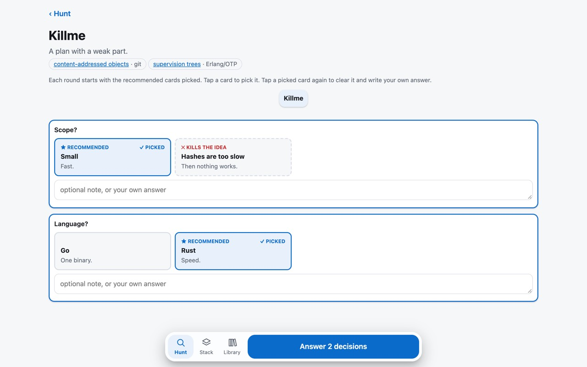
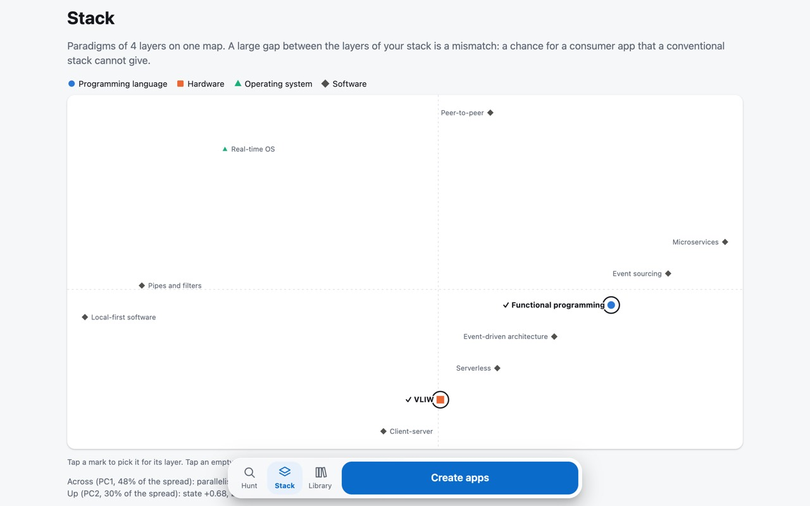

# snowmobile

Snowmobile hunts real software tools and programming paradigms for their parts, and recombines distant parts into new developer tools, or into consumer apps in Stack mode. It kills each idea that already exists, then grills you on a survivor as a visual design tree: one tap per decision, until you have a build brief.



```
seed ──► hunt parts ──► recombine ──► prior-art check ──► grill tree ──► build brief
         (web search)                  (dead ones go to                (a decision that kills the
                                        the graveyard)                  idea marks the bad part)
```

## Start

You need Node.js 22.13 or later and [Claude Code](https://claude.com/claude-code), signed in. Snowmobile runs your local `claude` CLI, so it uses your own login and needs no API key.

```sh
npx github:yujieteo/snowmobile
```

Open the URL that it prints. The URL holds a token. Without the token, the server refuses each request.

Snowmobile is a server because a browser cannot run Claude Code, and because you can then use it from your phone.

## Use it from your phone

The server listens only on `127.0.0.1:4747`. From a device with SSH access to the machine that runs snowmobile, forward the port:

```sh
ssh -L 4747:127.0.0.1:4747 your-machine
```

Then open the printed URL, with its token, in the browser on that device.

## Your data

Everything stays in one SQLite file on your machine: `~/.snowmobile/snowmobile.db`. It holds the parts and their source links, the paradigms, axes and scores of the stack map, the ideas, the graveyard and each grill tree. The library page searches the hunts, the parts and the ideas. Set `SNOWMOBILE_HOME` to keep the file somewhere else, and `PORT` to change the port.

## How it works

- **Hunt.** From your seed (a pain, a domain, a tool or a paradigm), Claude searches the web for 6 real tools and paradigms. It breaks each one into its principal components: the mechanisms that make it work, each with a link to its source. "Hunt more parts" adds more.
- **Create.** Claude combines parts from distant sources into candidates. Each candidate must name the problem and who has it, a link that shows the problem is real, the solution that people use today, and the gain over it on one axis, with a claim that a test can prove false. Claude then searches for prior art. A candidate that exists, that has no real source for its problem, or that has no clear gain goes to the graveyard with the reason. The idea card shows these 4 lines first.
- **Grill.** Each round shows every open decision whose prerequisites are settled, with the recommended card already selected. One tap answers the round. Tap another card or type a note to override. While you read a round, snowmobile already computes the next round for the recommended answers, so the next round usually appears at once. The first round always tests why the idea is better than the solution that people use today. A decision that kills the idea sends you back to the hunt with the bad part marked, and the next creation leaves that part out. The build brief starts with the problem, the evidence, today's solution and the gain.
- **Change your mind.** Swipe an idea left to bury it, or swipe a graveyard entry right to restore it. Each card also has a button for this. Leave out a part, or bring it back, on the parts tab. Undo the last round of a grill, also a kill or a finished brief. Each change shows "Undo" at once, so snowmobile never asks you to confirm.

## Stack mode

Stack mode makes consumer apps from a stack of 4 paradigms: one programming language paradigm, one hardware paradigm, one operating system paradigm and one software paradigm. Tap **Stack** at the bottom of the screen.



- **Paradigms.** The seed list covers all 4 layers, with a definition and source link for each entry. Sources include taxonomies, papers, project documentation and architecture styles. "Hunt more paradigms" finds more on the web, each with a source link. Each start adds absent seeds to an existing database and keeps user edits.
- **Axes.** Claude proposes 8 to 12 design axes once, for example where state lives or when binding happens. Each axis runs through all 4 layers. Then Claude scores each paradigm on each axis from 0 to 10, with a one-line reason. You can edit each axis and each score. A new score never replaces your edit.
- **Map.** Principal component analysis puts all paradigms on a 2D map, with a colour and a shape for each layer. Tap a mark to pick it for its layer. Tap an empty area, and Claude tells you which paradigm would live at that point.
- **Gaps.** With 2 or more picked paradigms, the page shows the gap between them on each axis. A gap of 5 or more is a mismatch: a chance for a new idea.
- **Create.** Write a consumer pain, pick a stack, or do both. If you do not pick a paradigm for a layer, Claude chooses one. Claude then proposes consumer apps that the stack makes possible, cheap or fast. The same checks as above send weak apps to the graveyard. The grill and the build brief are the same as in the other mode, and the brief also names the layer mismatch that the app uses.

## Repository subset

Use `node scripts/select-repos.js <scores.json> <count>` to select distant repositories from a score file.
Reason: a distant subset supplies distinct sources for the paradigm search.
The file has `axes`, an array of distinct axis names, and `repos`, an array of repository records.
Each record has a GitHub `url` and a `scores` array, with one value from 0 to 10 per axis.
Use the same axis order and definitions as the Stack map. Keep source links and score reasons in each record.
The script preserves those extra fields in its JSON output.

The script starts with the most distant pair, then selects the repository farthest from its nearest selected repository.
It uses Euclidean distance on the full axis scores, with equal weight per axis. Ties follow input order.
The output includes the selected records and their minimum pair distance. The method is greedy and does not guarantee the best subset.
This step requires scores from source evidence. It does not fetch repositories, assign scores, or verify candidate paradigms.

For joint PCA, add a nonempty `paradigms` array to the same file.
Reason: repositories and paradigms need one coordinate frame for a valid map comparison.
Each paradigm has `name`, `layer` (`language`, `hardware`, `os`, or `software`), and `scores` in the same axis order.
Keep its definition, source links, and score reasons in the record too.
The optional `map` output uses the Stack PCA code, with column means, two component vectors, variance shares, and point coordinates.
Its `records` array identifies each point by `kind` and the full input `record`, at the same array index.
PCA uses all input repositories and paradigms, so the subset count cannot change the coordinate frame.
Scores have equal weight per axis. PCA subtracts each axis mean but does not divide by its standard deviation.
Two components can omit distance on other components. Use the full axis scores for repository selection.
The script reads only its input file and does not open a Snowmobile database.

Try `node scripts/select-repos.js data/repo-scores.json 3` for a source-backed subset.
Reason: synthetic profiles cannot supply real sources for the paradigm search.
The file records manual estimates, axis endpoints, per-score reasons, and source links, with a fixed Git revision for each README.
Scores describe each record's stated scope. They do not measure performance or code quality.
Some midpoint scores mark uncertain evidence. Review their reasons before a conclusion.
These study axes do not replace your Stack axes.
The same file includes source-backed profiles of existing seeds from all 4 layers for joint PCA.
Reason: the repository-only corpus produced no joint map in the regression test.
Each profile describes the cited example within its stated scope, rather than every implementation of that paradigm.
For example, the Unikernel profile scores libraries within one image, while the Unikraft repository profile has uncertain evidence for component isolation.
The output retains both scopes and their reasons. Review those differences before a conclusion.
Use `map.explained` to check how much variance the first 2 components retain.
With paradigm profiles, the output also has `gaps`, ordered by distance on the map.
Reason: the real corpus returned a joint map but no search regions near the selected repositories.
Each region uses a selected repository point as its centre and retains that repository's source evidence.
`nearestOnMap` gives the nearest scored paradigm and the radius of the open circle with no scored paradigm inside.
`nearestOnAxes` gives the nearest scored paradigm across all axes. Its distance can reveal separation that the map omits.
The nearest paradigm can differ between these spaces. Distances below or equal to 1e-9 count as zero.
The script omits regions with zero distance in either space, so an exact profile match supplies no gap.
These regions suggest places to search for real paradigms. They do not name or verify new paradigms.
Only input paradigm profiles bound these regions. Unscored seeds can already occupy them.

The Rocket Chip region supplied the **Hardware generators** seed and its profile, with eight score reasons and a `suggestedBy` repository link.
Reason: the study run placed Rocket Chip 6.71 units from its nearest paradigm across all eight axes.
The [Rocket Chip report](https://www2.eecs.berkeley.edu/Pubs/TechRpts/2016/EECS-2016-17.html) confirms that a generator composes components and emits a circuit description.
This paradigm covers the circuit generator, while **Pipelined RISC processor** covers one core architecture.
The profile uses the repository scope and scores, so the joint map now omits that covered region.
These scores remain manual estimates. The component isolation score still marks uncertain evidence.

The Erlang/OTP region matches the **Actor model** seed, so the study adds its profile instead of a duplicate seed.
Reason: the study run placed Erlang/OTP 16.58 units from the nearest scored paradigm across all eight axes.
The [Erlang tutorial](https://www.erlang.org/doc/system/conc_prog.html) describes private process data, message queues, and messages across computers.
The profile uses the repository scope and records eight score reasons plus its `suggestedBy` link.
This profile removes the last region for the selected three repositories. It does not establish complete coverage of the seed list.
Other actor implementations can differ. The durable state score still marks uncertain evidence.

## Interface

The interface comes from a conceptual model: the objects, their relationships, their actions and their attributes. [docs/concepts.md](docs/concepts.md) has the model and the object-action matrix. The content fills the screen. The navigation and the primary action of each screen float above it at the bottom, within reach of your thumb. [docs/screens](docs/screens) has a screenshot of each screen at 375, 430 and 1280 px.

## Credits

- The name and the method come from John Boyd's essay [*Destruction and Creation*](https://www.coljohnboyd.com/static/documents/1976-09-03__Boyd_John_R__Destruction_and_Creation.pdf) (1976). Boyd takes skis, an outboard motor, tank treads and bicycle handlebars out of their unrelated wholes and recombines them into a snowmobile.
- The grill comes from Matt Pocock's [grill-me](https://github.com/mattpocock/skills/blob/main/skills/productivity/grill-me/SKILL.md) prompt, in which an LLM interviews you about a plan, one branch of the design tree at a time, with a recommended answer for each question.

## Development

```sh
npm test
```

The tests run the server against a fake `claude`. Snowmobile has no dependencies.

MIT licence.
